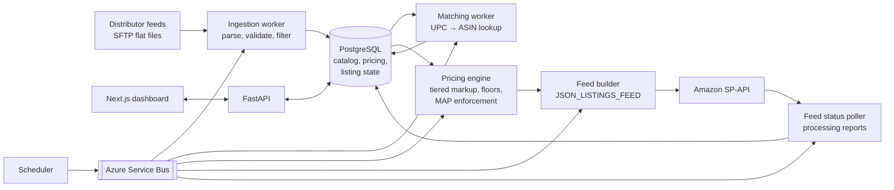

# BMG Commerce OS — Case Study

> Multi-tenant commerce automation platform that syncs a national IT distributor's catalog to Amazon — designed, built, deployed, and operated on Azure by one person.

**Role:** Founder / architect / engineer · **Status:** In production for my own store; SaaS billing layer in progress
**Source code:** private (commercial product). This repo documents the architecture, decisions, and problems solved.

---

## The problem

My company resells IT hardware from a national distributor on Amazon. The distributor publishes its catalog as daily flat-file feeds (item list, categories, discontinued items) — tens of thousands of SKUs with cost, stock, and UPCs, but **no Amazon identifiers and no images**. Listing and repricing by hand doesn't scale past a few dozen products, and stale stock or prices on Amazon mean cancelled orders and account-health penalties.

## What I built

An automation engine that runs the full listing lifecycle, then a platform around it so other sellers can use it.

| Layer | Technology |
|---|---|
| API | Python, **FastAPI**, Pydantic |
| Workers | **Celery** workers triggered via **Azure Service Bus** queues |
| Database | **PostgreSQL** (Azure Flexible Server), Alembic migrations |
| Frontend | **Next.js** / TypeScript |
| Hosting | **Azure Container Apps** (API, workers, scheduler, migration job), Azure Container Registry |
| Infra as code | **Bicep** + PowerShell deployment scripts |
| Observability | **Log Analytics** workspace, container console logs, health endpoints |
| Integrations | Amazon **Selling Partner API** (Listings, Feeds, Reports) |
| Budget | Designed to run **under $50/month** |

## Key engineering decisions

- **Staged rollout of bulk listings.** Amazon penalizes bad listing data at scale, so uploads grow in stages — **10 → 100 → 1,000 → 5,000** products — each feed monitored to `DONE` and its processing report reviewed before the next. A feed is never resubmitted while one is `IN_PROGRESS`. The 10-, 100- and 5,000-product stages all completed successfully.
- **Rule-based pricing, not hand-pricing.** A tiered markup on distributor cost (higher multiplier on cheap items, lower on expensive ones) with hard floors: never below distributor cost + fees, never below MAP.
- **Business-rule filtering at ingestion.** Restricted brands and items that require manufacturer authorization are excluded before they can ever reach a listing.
- **Queue-driven workers.** Each stage is an independent worker fed by Service Bus, so a slow SP-API call or a failed batch doesn't block ingestion, and work can be retried safely.
- **Multi-tenant from the data model up.** Organizations, roles, and per-tenant credentials are first-class so the same engine can serve other sellers.

## Problems I diagnosed and fixed in production

These are the kind of issues that don't show up in tutorials.

### 1. Database migration job failing on Azure — root cause in a password character

**Symptom:** the Container Apps migration job failed every run; the job's log stream showed *"No replicas found for execution"* and nothing useful.
**Investigation:** the job's replica is gone by the time you look, so I queried the **persistent `ContainerAppConsoleLogs_CL` table in Log Analytics** instead of the transient log stream, which surfaced the real stack trace.
**Root cause:** the PostgreSQL password contained a URL-encoded `!` (`%21`). Alembic passes the connection URL through Python's `configparser`, which treats `%` as an interpolation character and crashed.
**Fix:** escape `%` → `%%` before calling `set_main_option`, rebuild the image with `az acr build`, re-run the job → **migration succeeded**, API health endpoint green, owner account initialized.

### 2. Infrastructure-as-code defects

- Bicep **secure parameters** and Service Bus key handling corrected so secrets are never emitted in deployment outputs.
- Fixed a PowerShell random-generation bug in the provisioning script.
- Fixed Python **package discovery** treating the `migrations` folder as a second top-level package, which broke the container build.
- Added a missing `azure-servicebus` dependency and removed a **duplicate migration** that tried to add the same MFA column twice.
- Added **bounded PostgreSQL connection retries** so containers survive the database's cold start instead of crash-looping.

## Roadmap — Phase 5: SaaS financial layer

Stripe-based subscriptions, billing portal, webhooks, an internal ledger, Stripe Connect payouts, a commission engine, and admin analytics. The same financial architecture is designed to be reused across my other products.

## What this project demonstrates

- Designing and operating a **cloud workload on Azure** end to end: networking, containers, registry, database, queues, logging, cost control
- **Troubleshooting from logs to root cause** when the obvious log source is empty
- **Infrastructure as code** and repeatable deployments
- **Secure handling of secrets** and least-privilege service configuration
- Integrating a large, rate-limited third-party API safely at scale
